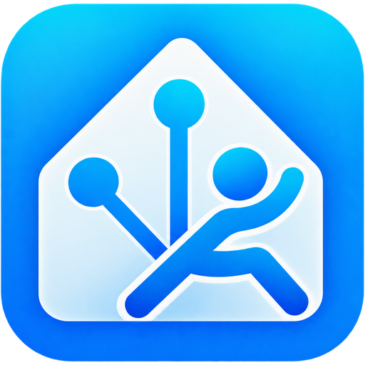

[](https://github.com/hacs/integration)
[](https://github.com/cloudbr34k84/ha-renpho-cloud-ble/actions/workflows/tests.yaml)
[](https://github.com/cloudbr34k84/ha-renpho-cloud-ble/actions/workflows/hassfest.yaml)
[](https://github.com/cloudbr34k84/ha-renpho-cloud-ble/actions/workflows/validate.yaml)

# Renpho for Home Assistant — Cloud + Bluetooth

<p align="center">
  
</p>

One integration for Renpho body-composition scales, with two independent ways to get your data in:

| Source | How it works | Works with |
|---|---|---|
| **Cloud** | Polls your Renpho Health account for each family member's latest measurement | Any scale that syncs to the Renpho Health app |
| **Bluetooth (local)** | Connects to the scale when you step on it — directly or through an ESPHome Bluetooth proxy — and decodes the measurement | LeFu-based scales (Bluetooth company ID `0x1A10`): the 0x55aa family and the MorphoScan family (R-MSC04, R-MSC06) |

You can add either or both. They are separate config entries with separate devices, so nothing is double-counted.

No extra Python packages are installed: the cloud client uses Home Assistant's built-in `aiohttp` and `cryptography`, and the Bluetooth protocol is implemented in the integration itself.

## Status

| | |
|---|---|
| Cloud | Ported from [ha-renpho-health](https://github.com/DiscountDarcy/ha-renpho-health) / [renpho-api](https://pypi.org/project/renpho-api/). The request encryption is byte-identical to `renpho-api` (checked in the test suite). |
| Bluetooth, known 0x55aa models (ES-CS20MB1, ES-CS20MB2, R-A012, R-A016, ES-26BB-B) | Frame decoding, guest-profile handshake and body-composition math ported from [renpho-escs20m](https://pypi.org/project/renpho-escs20m/) and checked against it in the test suite. Not yet tested on hardware by this project. |
| Bluetooth, **MorphoScan family (R-MSC04, R-MSC06)** | **Experimental.** Our own implementation of the protocol that the [ble-scale-sync](https://github.com/KristianP26/ble-scale-sync) project documented from real R-MSC04 captures (issues [#117](https://github.com/KristianP26/ble-scale-sync/issues/117) and [#434](https://github.com/KristianP26/ble-scale-sync/issues/434)). It is tested against those captured frames. The R-MSC06 advertises the same `00 12` family prefix as the R-MSC04, with model `0x0041` instead of `0x0035`, but no R-MSC06 weigh-in has been decoded yet. |

If your scale isn't decoded locally yet, use the cloud source. It works today for anything the Renpho app supports.

## Installation

### HACS (custom repository)

1. Open **HACS** in Home Assistant.
2. Open the **⋮** menu → **Custom repositories**.
3. Add `https://github.com/cloudbr34k84/ha-renpho-cloud-ble` with type **Integration**.
4. Find **Renpho (Cloud + Bluetooth)** in HACS and download it.
5. Restart Home Assistant, then open **Settings → Devices & services → Add integration → Renpho**.

### Manual installation

1. Download a release from [GitHub Releases](https://github.com/cloudbr34k84/ha-renpho-cloud-ble/releases) and extract it.
2. Copy `custom_components/renpho/` into your Home Assistant configuration directory as `config/custom_components/renpho/`.
3. Restart Home Assistant and add **Renpho** from **Settings → Devices & services**.

Requires Home Assistant 2026.10 or newer.

### Repository layout

HACS installs the contents of `custom_components/renpho/` into Home Assistant's
`config/custom_components/renpho/` directory. Keep the `renpho` folder name: it
matches the integration's manifest domain.

```text
ha-renpho-cloud-ble/
├── hacs.json
├── README.md
└── custom_components/
    └── renpho/
        ├── __init__.py
        ├── manifest.json
        ├── brand/
        ├── translations/
        └── ...
```

`hacs.json` stays at the repository root with `content_in_root: false`.
Tests, development scripts and documentation stay outside the integration
folder so HACS only installs runtime files. For a manual installation, copy
only the `renpho` folder, not the entire repository.

## Setup

### Cloud

*Settings → Devices & services → Add integration → Renpho → Renpho Health account (cloud)* and enter your Renpho Health email and password. One device appears per family member on the account (`Renpho Cloud <name>`). Cloud measurements are checked every 30 minutes, suitable for occasional weigh-ins and avoiding unnecessary API requests. To choose a custom interval, disable automatic polling in the entry’s system options and use an automation calling `homeassistant.update_entity` on a cloud sensor. Existing custom polling options are superseded by this fixed default.

Accounts created before 2024 may need migrating to the Renpho Health app first. Very short polling intervals can hit Renpho's API rate limits.

### Bluetooth

Step on the scale to wake it. Home Assistant discovers it automatically ("Renpho R-MSC06 (60:65:…)"), or you can add it through *Add integration → Renpho → Bluetooth scale (local)*.

Then add each person who uses the scale: open the scale's entry and choose **Add person**. Enter their name, sex, birthday, height, current weight and a matching tolerance. Each person gets their own device (`Renpho Scale <name>`).

Requirements and tips:

- An adapter or proxy that can make **connections**. ESPHome proxies need `bluetooth_proxy: active: true`.
- The scale accepts one Bluetooth connection at a time. If the Renpho app is open and connected, Home Assistant can't connect, and the reverse is also true.

#### How a reading is assigned to a person

The scale doesn't know who is standing on it. Each reading goes to the person whose **last weight** (or starting weight, before their first reading) is closest, provided it's within their tolerance (default ±3 kg). Readings that match nobody update only the scale's own *Last weight* sensor and show *Last person: unassigned*.

If the wrong person was picked, call `renpho.reassign_last_measurement`. It moves the reading and restores the other person's previous one.

Body composition depends on the scale family:

- **0x55aa family:** calculated from the measured impedance and the person's profile, using the same formulas as the scale firmware (algorithm 0x04 by default, 0x03 optional, plus athlete mode). Readings without impedance, such as shoes on or a weight-only fallback, update weight and BMI only.
- **MorphoScan family:** the scale analyses the reading itself and sends body fat, visceral fat, skeletal muscle and five-segment impedances. Water, bone, muscle mass, protein and BMR are then derived from that body fat. See below for when the scale's figures are used.

#### MorphoScan scales (R-MSC04, R-MSC06)

On every connection Home Assistant writes a temporary **guest profile** (slot 9, which the scale does not keep as a user) and the **clock**, and acknowledges the scale's status messages. Without that handshake these scales hang up within a few seconds. The weight arrives as soon as it settles. The scale's own analysis follows 10–20 s later, so stay on until the display finishes.

The guest profile includes one byte that hasn't been decoded (probably sex and age). Without the byte the Renpho app writes for that person, the scale's body fat may be computed for the wrong sex or age, so **by default only weight and BMI are recorded locally.** To get the scale's body fat, visceral fat and skeletal muscle, set the person's **Scale profile byte**. It is the 12th byte of the `55 aa b2 …` frame the Renpho app writes to characteristic 0x2A11. To find it, capture a weigh-in made with the Renpho app:

- **Android:** use *Developer options → Bluetooth HCI snoop log*, then open `btsnoop_hci.log` in Wireshark.
- **iPhone:** use PacketLogger on a Mac.

The scale's figures are only used if three checks pass: it answered that person's profile before finishing, and the BMI it reports matches their configured height. Otherwise the reading falls back to weight and BMI. With several people, Home Assistant first sends the likeliest person's profile. If the settled weight matches someone else, it re-sends with theirs before the scale finishes analysing.

Without a profile byte, use the cloud source alongside Bluetooth for the full analysis. It isn't known yet whether a weigh-in that Home Assistant receives is still synced to the Renpho app afterwards.

The link sometimes drops about 5 s after connecting, before the analysis arrives. The weight is kept, and body composition is skipped for that weigh-in.

#### Options

| Option | Default | Meaning |
|---|---|---|
| Send guest profile to scale | Auto | MorphoScan scales need the guest profile and clock on every connection. "Extended" 0x55aa scales (ES-CS20MB2) only release a final reading after a guest profile is written. *Auto* writes only where needed, *Never* is fully read-only (MorphoScan scales then hang up), and *Always* also tries it on unknown 0x55aa models. |
| Capture all BLE characteristics | On | Subscribes to every notify/indicate characteristic and reads every readable one once, recording all traffic for diagnostics. |

## Entities

**Cloud person:** weight, BMI, body fat, body water, skeletal muscle (%), bone mass, BMR, visceral fat, subcutaneous fat, protein, body age, muscle mass, fat-free mass and last measurement. Heart rate appears only for scales that measure it. Weight, body fat, bone mass, BMR and muscle mass carry the app's healthy range as `normal_min` / `normal_max` / `standard` attributes.

People weighed on a body-composition analyser (8-electrode, e.g. R-MSC04/R-MSC06) also get these sensors. They appear only if the person's records contain them:

- **Whole body:** body fat mass, skeletal muscle mass and index, body score, body type (Renpho's code), waist-hip ratio, obesity degree, target weight, and weight, fat and muscle control (kg to gain or lose).
- **Each arm, each leg and the trunk:** fat mass and muscle mass in kg, plus each as a percentage of that segment's standard mass. 100 % means on standard; the standard mass is in the `standard` attribute.
- **Impedance:** 20 kHz and 100 kHz per segment, disabled by default.
- **Muscle mass percentage.**

**Status:** low / normal / high for weight, body fat, body fat mass, muscle mass, skeletal muscle mass, bone mass, BMR, body water and protein. Each is judged against the healthy range Renpho sends with the reading (water and protein as kg of body weight, which is how Renpho states those ranges), and appears only when that range is present.

**Measurement event:** each cloud person has an `event.renpho_cloud_<name>_measurement` entity. It fires once for every new weigh-in, with weight, body fat, BMI and the other headline numbers as attributes, so automations can trigger on the event itself. Readings already in the account when Home Assistant starts don't fire. Weigh-ins made while Home Assistant was down fire once it's back.

**Faster updates after a weigh-in:** if a Renpho Bluetooth scale is also set up, waking it up (stepping on it) triggers cloud checks about 1½ and 5 minutes later. Cloud data then arrives within minutes, without waiting for the polling interval.

**Goals:** from each account's profile in the Renpho Health app: weight goal, weight to goal (latest weight minus goal), goal date, body fat goal, starting weight and body fat, waist and hip. Each sensor appears once that value is set in the app. Values are converted to kg and cm if the app stores lb or inches.

**History:** every cloud measurement is written into the matching sensors' long-term statistics at the time it was taken. The graphs therefore go back as far as the Renpho account does, and weigh-ins between two polls aren't lost. The first time a sensor is seen, its full history is imported once; after that only new measurements are added. To re-import everything, call `renpho.import_history` for the cloud entry. This needs the recorder (part of the default config).

**Bluetooth person:** weight, BMI, body fat, body water, skeletal muscle, muscle mass, bone mass, fat-free mass, protein, BMR, visceral fat (MorphoScan only), impedance (0x55aa only, disabled by default) and last measurement.

**Bluetooth scale:** last weight, last person, last measurement, battery and connection status. Raw impedance and signal strength are diagnostic sensors disabled by default.

Every Bluetooth reading also fires a `renpho_measurement` event:

```yaml
event_type: renpho_measurement
data:
  address: "60:65:F4:12:34:56"
  weight: 82.4
  resistance: 500
  profile: Alex          # null when unassigned
  profile_id: 01K...     # person subentry id
  method: final          # final | record (connected late) | plateau (settled weight only)
  reassigned: false
  scale_record:          # MorphoScan only: the scale's own analysis, or null
    body_fat: 23.7
    bmi: 27.3
    skeletal_muscle: 43.9
    visceral_fat: 8
    impedance_20khz: [22.2, 310.4, 305.5, 227.6, 234.6]   # trunk, L arm, R arm, L leg, R leg
    impedance_100khz: [17.4, 275.3, 270.4, 201.7, 208.5]
    trusted: false       # true when it was used for the person's sensors
```

## Helping add a scale

Every Bluetooth session records the scale's full GATT table (with the values of readable characteristics), every subscription result, and the raw bytes of every notification on every characteristic.

1. Leave **Capture all BLE characteristics** on.
2. Step on the scale and stay on until the display finishes, including body fat if it shows it.
3. *Settings → Devices & services → Renpho → ⋮ → Download diagnostics*.
4. Open an issue and attach the file. Mention what the display showed: weight, and body fat if shown.

Diagnostics redact credentials, names, birthdays, heights, serial numbers and opaque BLE payload bytes. They keep command/timing information, firmware/battery information, connection status, and measurements including weights. Review the measurements before sharing. Raw payloads needed to investigate unknown protocols are available through debug logging; downloadable diagnostics omit them.

## Troubleshooting

| Symptom | What to check |
|---|---|
| *Connection status* shows **No connectable proxy** | No adapter or proxy that can make connections can hear the scale. ESPHome proxies need `bluetooth_proxy: active: true`. Move a proxy closer, or check *Signal strength* (enable it first). |
| Status goes *Connecting* then *Error* | The Renpho app on a phone is probably holding the scale's only connection. Close the app and try again. The status sensor's `last_error` attribute has the details. |
| Readings land on *unassigned* | Nobody's last weight is within their tolerance. Widen the person's tolerance, or call `renpho.reassign_last_measurement`. |
| Weight but no body fat | No impedance was measured (shoes on, or the scale's pregnancy mode), or the reading fell back to the settled weight (`method: plateau`). |
| MorphoScan: weight but no body fat | Expected without a *Scale profile byte* (see MorphoScan scales above), or when the link dropped before the analysis. The `renpho_measurement` event's `scale_record` shows what the scale sent. |
| MorphoScan: *Connecting* then nothing | Check that *Send guest profile* isn't set to *Never*. Download diagnostics: `ble.writes` shows whether the handshake was answered. |
| Cloud sensors go unavailable | Look for a re-authentication prompt on the Renpho entry under *Settings → Devices & services*, and check *Settings → System → Logs* for `renpho`. Rate limiting pauses polling until Renpho's `Retry-After` time passes. |

Debug logging, which logs every Bluetooth notification as hex:

```yaml
logger:
  logs:
    custom_components.renpho: debug
```

## Recovery

- **Wrong person matched repeatedly:** edit the person and correct their current weight. Matching uses their last stored reading.
- **Remove a person:** delete them from the scale's entry. Their device, entities and stored readings are removed.
- **Start over with a scale:** delete the entry. Stored readings (`.storage/renpho.<entry_id>`) are deleted with it. It is rediscovered the next time you step on the scale.
- **Changed Renpho email:** edit the prefilled email in the reauthentication prompt; signing into the same account preserves entities and history.
- **Changed Renpho password:** the next poll fails to log in and Home Assistant shows a re-authentication prompt on the entry. Enter the new password there.
- **Different Renpho account:** delete the cloud entry and add it again.

## Credits

Built on the work of these projects:

- [DiscountDarcy/ha-renpho-health](https://github.com/DiscountDarcy/ha-renpho-health) and [renpho-api](https://pypi.org/project/renpho-api/): the Renpho Health cloud API.
- [ronnnnnnnnnnnnn/renpho_fitness_scale_ble](https://github.com/ronnnnnnnnnnnnn/renpho_fitness_scale_ble) and [renpho-escs20m](https://pypi.org/project/renpho-escs20m/): the 0x55aa protocol, captures and body-composition formulas.
- [KristianP26/ble-scale-sync](https://github.com/KristianP26/ble-scale-sync): the MorphoScan (R-MSC04) protocol, worked out with its users from real captures. That project is GPL-3.0, so only the documented wire facts are used here; no code is copied.

This project is MIT-licensed (see [LICENSE](LICENSE)); the upstream projects' notices are in [NOTICE](NOTICE). Not affiliated with or endorsed by Renpho.

## Removing the integration

1. Open **Settings → Devices & services → Renpho**.
2. Open each account or scale entry’s three-dot menu and select **Delete**. Repeat for all entries.
3. Remove Renpho from HACS, or delete `custom_components/renpho` for a manual installation, then restart Home Assistant.

Deleting a Bluetooth entry removes its stored local readings and profiles. Deleting a cloud entry removes the history-import tracking file; it does not delete your Renpho account or cloud measurements. Recorder history and imported long-term statistics follow Home Assistant’s recorder retention and statistics management.

## Action reference

Both actions require a loaded Renpho entry. `renpho.reassign_last_measurement` requires `config_entry_id` (Bluetooth entry) and `profile_id` (person subentry ID). It assigns the last reading to that person and takes no response. `renpho.import_history` requires `config_entry_id` (cloud entry), resets import tracking and imports all available measurements; its optional response is `hours_imported`, the number of hourly statistic records imported. See the measurement event examples above for automation triggers. The integration provides no custom conditions or device triggers.

## Setup fields and options

Cloud setup asks for **Email** and **Password** from the Renpho Health app (blue icon). Use the email shown in the app's account settings. Google/Apple sign-in alone does not provide a Renpho password. If the password changes, enter the current **Email** and **Password** in the reauthentication prompt; the account must remain the same. The email is prefilled and can be changed if you changed it in Renpho Health.

Bluetooth setup asks for **Scale**: choose a supported scale discovered nearby. Wake it by stepping on it. No address needs to be typed.

Choose **Add person**, or edit an existing person, for these fields:

| Field | Meaning and suitable values |
|---|---|
| Name | The person's name, unique within this scale. |
| Sex | Male or Female, used by the body composition formula. |
| Birthday | The person's date of birth, used to calculate age. |
| Height | Height in centimeters, 50–250 cm. |
| Current weight | Starting weight, 10–300 kg; used for matching until a reading is stored. |
| Matching tolerance | Maximum difference from the person's last weight, 0.5–15 kg; default 3 kg. Use a smaller value when people's weights are close. |
| Body-fat algorithm | Default (0x04) for most scales; Alternative (0x03) if the default differs from the app. |
| Athlete mode | Enable only when the person uses athlete mode in the Renpho app. Default off. |
| Scale profile byte (MorphoScan, optional) | Two hex digits from the app's profile frame; see the MorphoScan capture instructions above. Leave empty if unknown. |

Open **Settings → Devices & services → Renpho → Configure** for Bluetooth options:

| Option | Meaning and suitable values |
|---|---|
| Send guest profile to scale | **Auto** (default): writes only for scale families that need the handshake. **Never (read-only)**: prevents writes, but MorphoScan scales then disconnect without a completed reading. **Always**: enables the guest-profile handshake for other supported scales when needed. |
| Capture all BLE characteristics (diagnostics) | Default on. Captures additional notifications for diagnosing protocol support. Turn off to limit subscriptions to known measurement characteristics. |

Cloud entries have no integration-specific options. Polling defaults to 30 minutes; use Home Assistant's standard polling controls described above to change it.

## Availability and errors

Cloud sensors and events become unavailable when a cloud update fails and recover when a later update succeeds. Missing individual metrics report unknown. Bluetooth readings describe the last completed weigh-in and remain valid while the battery-powered scale sleeps. A failed connection or missing connectable adapter makes the measurement sensors unavailable until a successful connection; the connection-status diagnostic remains visible. Loss and recovery are each logged once, with repeated failures kept quiet.

Actions report invalid targets, unknown profiles, missing readings and disabled recorder support as validation errors. History download/storage failures report an action error so automations stop instead of silently continuing.

## Data updates

Cloud entries poll every 30 minutes. A local Bluetooth scale waking up also schedules cloud checks 90 and 300 seconds later. Each check reads the account and family members from Renpho Health; the first history import may make many paginated requests. Renpho's exact request quota is not documented by this integration. HTTP 429 responses pause polling for the server's `Retry-After` duration, or 15 minutes when it supplies no usable duration. Shorter polling and repeated full-history imports increase the chance of rate limiting.

Bluetooth uses advertisements to start a connection, then receives measurement notifications. It does not poll a sleeping scale. Only a completed reading or a stable-weight fallback updates measurement sensors; live settling weight is diagnostic information on the connection-status sensor. Cloud and Bluetooth readings remain separate so you can choose the source for each dashboard or automation.

## Supported and unsupported devices

The Status table above distinguishes protocol-tested support from hardware verification. Cloud support depends on measurements reaching **Renpho Health**. The local decoder handles manufacturer ID `0x1A10`, basic/extended `0x55aa` frames and experimental MorphoScan frames. Known model labels include ES-CS20MB1, ES-CS20MB2, R-A012, R-A016, ES-26BB-B, R-MSC04 and R-MSC06; protocol recognition does not establish that every firmware version works.

Other Bluetooth manufacturer IDs and unrelated protocols are rejected. A device that cannot expose a supported Bluetooth protocol cannot use the local source; it may still use cloud if it syncs to Renpho Health. Google/Apple-only sign-in without a Renpho password is unsupported. Accounts in older Renpho apps may require migration to Renpho Health.

## Known limitations

- Local MorphoScan support is experimental. A profile byte and matching height are needed before the scale's analysis is trusted. A connection that drops before analysis completes can provide weight only.
- A scale accepts one Bluetooth connection at a time. Close the phone app when using local capture. Receiving a reading locally does not guarantee that it subsequently syncs to the cloud.
- Cloud data arrives only after the Renpho app uploads it, and can lag behind a local reading. The integration cannot force an app upload.
- Local profile matching uses weight, so people with similar weights can be confused. Use the reassignment action to correct the last reading.
- The integration reads measurements; it does not configure pregnancy mode, manage Renpho account members, or replace the manufacturer's app.
- Model recognition and complete test coverage do not replace hardware testing. The Status table records the known verification level.

## Use cases and automation examples

Use local readings to record a weigh-in immediately, cloud history to show long-term trends, and cloud Measurement events to run an automation once per uploaded weigh-in. Family members and optional metrics are added automatically when later cloud updates contain them. Set goals in Renpho Health and show the goal sensors beside your latest weight on a dashboard.

These examples go in the automation editor's YAML view. Replace the address or entity ID with your own. They use Home Assistant's built-in persistent notifications.

### Notify after a local weigh-in

```yaml
alias: Renpho local weigh-in
triggers:
  - trigger: event
    event_type: renpho_measurement
    event_data:
      address: "60:65:F4:12:34:56"
conditions:
  - condition: template
    value_template: "{{ not trigger.event.data.reassigned }}"
actions:
  - action: persistent_notification.create
    data:
      title: New weigh-in
      message: "{{ trigger.event.data.profile or 'Unassigned' }}: {{ trigger.event.data.weight }} kg"
mode: queued
```

### Notify after a cloud measurement event

```yaml
alias: Renpho cloud weigh-in
triggers:
  - trigger: state
    entity_id: event.renpho_cloud_alex_measurement
    not_from:
      - unknown
      - unavailable
    not_to:
      - unknown
      - unavailable
conditions:
  - condition: template
    value_template: "{{ trigger.to_state.attributes.get('event_type') == 'measurement' }}"
actions:
  - action: persistent_notification.create
    data:
      title: Renpho cloud measurement
      message: "New weight: {{ trigger.to_state.attributes.get('weight') }} kg"
mode: queued
```

### Reassign a reading

Run this action in Developer Tools → Actions, or use it as an automation action. Replace both IDs with those of your scale and person:

```yaml
action: renpho.reassign_last_measurement
data:
  config_entry_id: YOUR_BLUETOOTH_ENTRY_ID
  profile_id: YOUR_PERSON_SUBENTRY_ID
```

## Device changes and Repairs

Rediscovery refreshes model information for a known Bluetooth address. Bluetooth addresses identify the hardware; changing the scale means adding a new entry. Cloud setup contains only account credentials; password changes use reauthentication. Edit a Bluetooth person's details through their subentry's reconfigure menu. These operations preserve entity unique IDs.

The cloud does not provide a guaranteed complete device inventory, so the integration does not automatically delete absent people. After a successful refresh that no longer includes a person's readings, their stale device can be deleted from its device page. Removal is refused during a failed cloud refresh or while that person still supplies readings. If they appear again in a later update, their entities are added again. Remove a Bluetooth person through the person subentry; remove the physical scale through its integration entry.

If Home Assistant hears a scale but has no adapter capable of connecting to it, a Repair explains how to add or move a Bluetooth adapter/proxy and enable active connections. It clears after a successful connection and is removed when the entry is deleted. Temporary connection errors stay in the connection diagnostic; invalid cloud credentials use Home Assistant's reauthentication prompt.
